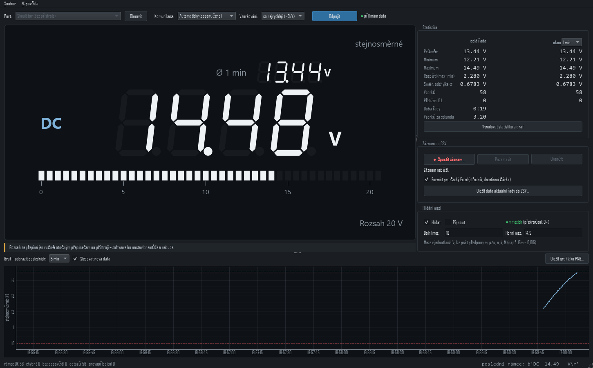
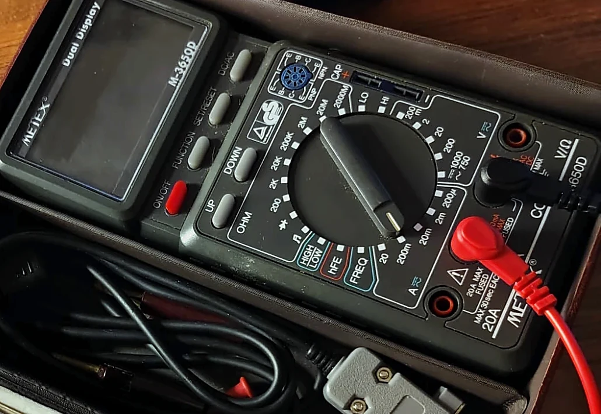
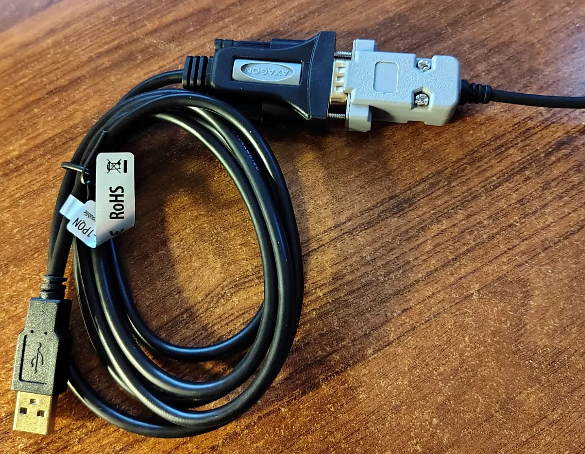
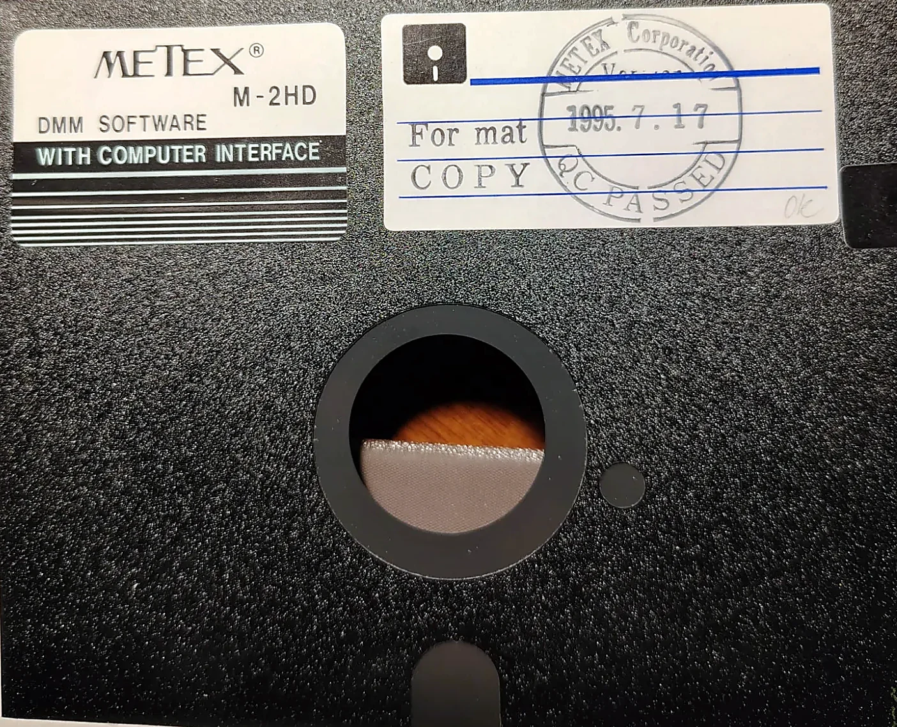

# Metex M-3650D v počítači

Aplikace pro Windows, která z multimetru **Metex M-3650D** (řada M-3600D,
„Dual Display“) dělá měřicí přístroj v počítači. Přes sériovou linku čte
hodnoty a zobrazuje je velkým displejem se sedmisegmentovými číslicemi
a bargrafem. Kreslí živý graf a počítá statistiku. Měření zapisuje do CSV
s časem a hlídá nastavené meze.



*Aplikace v režimu simulátoru: hlavní displej, klouzavý průměr na vedlejším
displeji, bargraf 0–20, statistika, záznam a graf s mezemi.*

| Přístroj | Převodník USB–RS-232 |
|---|---|
|  |  |

## Historie přístroje

Metex M-3650D je ruční multimetr řady **M-3600D** od korejské firmy METEX
Corporation. Tato řada se objevila v polovině 90. let. Přístroj má
3½místný displej (2000 bodů) a vedlejší displej pro frekvenci, odtud nápis
„Dual Display“. Dál má bargraf, rozsahy napětí, proudu do 20 A, odporu,
kapacity a frekvence, měření hFE, test diod a logickou sondu. Má také
**rozhraní RS-232**, na tehdejší ruční multimetr nevšední výbavu.
U nás se prodával s českým návodem a v zahraničí také jako Voltcraft
M-3650D.

Náš kus je z roku 1999 a zdědili jsme ho po dědečkovi. Dodnes je kompletní:
kufřík, měřicí šňůry, kabel RS-232, český návod i původní disketa
s programem. A pořád měří.

Podrobnosti o přístroji jsou v [docs/pristroj.md](docs/pristroj.md).

## Motivace

Přístroj, který umí posílat data do počítače, by neměl skončit v šuplíku jen
proto, že jeho software potřebuje MS-DOS, grafiku VGA a 5¼" disketovou
mechaniku. Chtěli jsme mu dát nový život:

- vidět měření na velkém displeji v PC, „1:1“ jako na přístroji;
- mít živý graf, statistiku a zápis do CSV, třeba pro dlouhodobé měření
  odběru zařízení na baterii nebo průběhu nabíjení;
- využít to, co přístroj umí od roku 1995, s dnešním počítačem
  s Windows 11 a převodníkem USB–RS-232;
- sepsat, jak rozhraní funguje, protože informace o něm jsou rozházené
  po starých návodech a zdrojích open-source projektů.

## Původní software



K přístroji se dodávala 5¼" disketa **METEX M-2HD „DMM Software with
Computer Interface“**. Na štítku je razítko kontroly kvality z 17. 7. 1995.
Obsahuje program **`METEX.EXE`** pro MS-DOS:

- spouští se z příkazové řádky, menu se otevírá klávesou F10;
- v nastavení (SETUP) se volí typ přístroje **„M36D“**;
- naměřená data ukládá do vlastních souborů s příponou **`.3UT`**;
- vyžaduje grafickou kartu a monitor **VGA**;
- výrobce ho označoval za ukázkový program bez záruky.

Na dnešním počítači se takový program provozuje jen obtížně. Chybí
mechanika na 5¼" diskety, DOS nemá přímý přístup k portu COM přes USB
a formát `.3UT` nic jiného nepřečte. Víc v
[docs/navod-komunikace.md](docs/navod-komunikace.md).

## Nové řešení

Tato aplikace původní program nahrazuje. Běží na Windows 10/11, čte
přístroj přes libovolný převodník USB–RS-232 s plnohodnotnými signály
a ukládá data do běžného CSV.

### Co aplikace umí

- **Displej jako na přístroji.** Ukazuje hodnotu, jednotku a režim (DC, AC,
  Ω, FREQ, CAP, hFE, dioda, logika). Rozsah odhaduje z formátu čísla.
  Bargraf má stupnici 0–20 a při přetížení O.L bliká jako originál.
  Symbol COM svítí, když přístroj vysílá sám.
- **Vedlejší displej** ukazuje klouzavý průměr za zvolené okno.
- **Živý graf** má časovou osu a volitelný úsek: 30 s až 6 h, nebo celý
  záznam. Jednotky na ose se přizpůsobují (mV, µA…). Přetížení se vyznačí
  červenými značkami, meze čárkovaně. Když vypnete „Sledovat nová data“,
  můžete graf posouvat a zvětšovat myší.
- **Statistika** se počítá za celou řadu i za klouzavé okno (10 s až 1 h):
  průměr, minimum, maximum, rozpětí, směrodatná odchylka, počet vzorků
  a počet přetížení O.L. Přidává dobu řady a počet vzorků za sekundu.
  Přetížení do průměru nevstupují.
- **Nová řada.** Když otočným přepínačem změníte měřenou veličinu
  (např. V → mA), statistika a graf začnou znovu. Pouhá změna rozsahu
  (20 mA → 200 mA) řadu nepřeruší, protože se vše počítá v základních
  jednotkách.
- **Záznam do CSV** se ovládá tlačítky Spustit, Pozastavit a Ukončit.
  Každý řádek se hned zapíše na disk, takže při pádu PC nic neztratíte.
  Formát je buď pro český Excel (středník a desetinná čárka), nebo
  standardní.
- **Export.** Data aktuální řady z paměti lze uložit do CSV (Ctrl+S), i když
  záznam neběžel. Graf lze uložit jako PNG.
- **Hlídání mezí.** Zadáte dolní a horní mez, třeba `4,5`, `15m` nebo `1,2k`.
  Při překročení se displej orámuje červeně, zvýší se počítadlo a přístroj
  volitelně pípne. Stav alarmu se zapisuje i do CSV.
- **Odolnost.** Neplatné rámce, ticho na lince i vytažení převodníku z USB
  aplikace přežije a sama se znovu připojí.
- **Simulátor.** Bez přístroje lze vše vyzkoušet: v seznamu portů zvolte
  „Simulátor“, nebo spusťte aplikaci s parametrem `--demo`.

**Bezpečnost:** do přístroje se posílá jen znak `D`, tedy dotaz na aktuální
hodnotu. V režimu „Aktivní – jen poslouchat“ se neposílá vůbec nic.
Aplikace nic nenastavuje a nic nevynucuje. **Rozsah se přepíná jen ručně
otočným přepínačem.** V proudových rozsazích přepnutí přeruší měřený obvod.
Aplikace na to upozorní červeným pruhem, kdykoli měříte proud.

### Proč Python + PySide6 (Qt) + pyqtgraph

- **pyserial** je osvědčená knihovna pro sériové porty. Umí přesně to, co
  Metex potřebuje: 7 datových bitů, 2 stop bity a ruční ovládání DTR/RTS
  pro napájení rozhraní.
- **Nativní okno místo webového UI.** Webové UI s lokálním serverem by
  přidalo další vrstvu, tedy server, port a prohlížeč, a víc míst, kde se
  může něco pokazit. Okno Qt je jeden proces, který se spustí dvojklikem.
  Sériový port drží jen on a po zavření ho spolehlivě uvolní.
- **pyqtgraph** kreslí graf s desetitisíci body plynule, umí časovou osu,
  předpony SI a zoom myší. Matplotlib by byl na živá data pomalý.
- **Python** je čitelný i pro ty, kdo chtějí protokol jen pochopit nebo
  upravit. Jádro (`protocol`, `link`, `stats`, `csvlog`) na Qt nezávisí,
  takže ho sdílí GUI, řádkový logger i testy a dá se použít i v jiném
  projektu.

## Co je potřeba, aby to fungovalo

### Hardware

1. **Multimetr Metex M-3650D.** Pravděpodobně půjdou i další přístroje se
   stejným 14znakovým protokolem, např. M-3610D, M-3630D, M-3640D a
   Voltcraft M-3650D. Ověřený je ale jen M-3650D.
2. **Originální kabel MT/RS232C.** Na straně přístroje má pětikolíkovou
   vidlici do boku, na straně PC konektor DB9 samice. Zapojení pinů je
   v [docs/zapojeni.md](docs/zapojeni.md), kdybyste si ho chtěli vyrobit.
3. **Převodník USB–RS-232 s plnohodnotným rozhraním**, tedy DB9 samec,
   úrovně RS-232 a hlavně vyvedené signály **DTR a RTS**. Rozhraní
   přístroje je oddělené optočlenem a napájí se právě z DTR (+) a RTS (−).
   Ověřený je **AXAGON ADS-1PQN** s čipem FTDI FT232R; kabel Metexu se na
   něj nasune přímo, bez redukce. Stejně poslouží i počítač se starým
   portem COM.

> **Nefungují** levné TTL převodníky se čtyřmi vodiči (5V, GND, TX, RX),
> např. moduly s PL2303. Nemají DTR ani RTS, takže rozhraní přístroje nemá
> napájení. Navíc mají opačnou polaritu signálu než RS-232. Vyzkoušeno.

### Ovladač

Převodníky s čipem FTDI mají ve Windows 10/11 ovladač z Windows Update.
Po zapojení se objeví ve Správci zařízení jako „USB Serial Port (COMx)“.
U jiných čipů nainstalujte ovladač výrobce. Staré čipy PL2303 (VID:PID
067B:2303) už Windows 11 nepodporuje.

### Software

- **Windows 10/11** (jádro a řádkový logger by měly běžet i na Linuxu,
  ověřené to není).
- **Python 3.11 nebo novější** z
  [python.org](https://www.python.org/downloads/). Při instalaci zaškrtněte
  „Add python.exe to PATH“.
- Knihovny z `requirements.txt`: **pyserial**, **PySide6-Essentials** (Qt),
  **pyqtgraph** a **numpy**. Nainstaluje je `Metex.bat` sám.

## Instalace

Stačí dvakrát kliknout na **`Metex.bat`**. Při prvním spuštění vytvoří
složku `.venv` a nainstaluje knihovny (asi 1–2 minuty, je potřeba internet).
Potom už rovnou spouští aplikaci.

Ruční instalace v PowerShellu (ve složce repozitáře):

```powershell
py -3 -m venv .venv
```

```powershell
.venv\Scripts\python -m pip install -r requirements.txt
```

```powershell
.venv\Scripts\pythonw -m metex_dmm
```

Bez přístroje: `.venv\Scripts\pythonw -m metex_dmm --demo`.

## Zapojení a první měření

Postup podrobně a s fotkami popisuje [docs/zapojeni.md](docs/zapojeni.md).
Ve zkratce:

1. Konektor kabelu Metexu (pětikolíková vidlice) zasuňte do zdířky v boku
   přístroje.
2. DB9 samici kabelu nasuňte na DB9 převodníku AXAGON a dotáhněte šroubky.
3. Převodník zapojte do USB.
4. Zapněte multimetr a otočným přepínačem zvolte funkci a rozsah.
5. Spusťte aplikaci, vyberte port (např. `COM10 – USB Serial Port …
   0403:6001`) a klikněte **Připojit**.

Aplikace si port pamatuje a příště se připojí sama.

## Ovládání

| Prvek | Význam |
|---|---|
| **Port / Obnovit** | Výběr COM portu. Převodníky FTDI, Prolific a CH340 jsou v seznamu nahoře. |
| **Komunikace** | *Automaticky* (doporučeno): ptá se `D` a pozná, kdy přístroj vysílá sám. *Pasivní*: vždy se ptá `D`. *Aktivní*: nic neposílá, jen poslouchá. |
| **Vzorkování** | Nejkratší odstup dotazů. „Co nejrychleji“ dává asi 2,8–3 vzorky/s. Pro dlouhé záznamy stačí 1–10 s. V aktivním režimu určuje tempo přístroj (asi 1/s). |
| **Připojit / Odpojit** | Spustí nebo zastaví komunikaci. Vedle je barevný stav linky. |
| **Statistika – okno** | Délka klouzavého okna. Klouzavý průměr se ukazuje i na vedlejším displeji. |
| **Vynulovat statistiku a graf** | Začne novou řadu. Probíhající záznam do CSV běží dál. |
| **Spustit záznam… / Pozastavit / Ukončit** | Zápis do CSV. Během pauzy se řádky nezapisují. |
| **Hlídání mezí** | Meze v základních jednotkách (V, A, Ω, F, Hz) s předponami m, µ/u, n, k, M. |
| **Stavový řádek** | Počty dobrých a chybných rámců, dotazů bez odpovědi a znovupřipojení. Vpravo je poslední surový rámec. |

### Pasivní a aktivní režim přístroje

Po zapnutí a po každém otočení přepínačem je přístroj v **pasivním** režimu.
Odpovídá jen na dotaz `D`. Tlačítkem **FUNCTION** se přepne do **aktivního**
režimu: na displeji svítí **COM** a přístroj sám vysílá asi 1× za sekundu.
V režimu *Automaticky* aplikace zvládne oba případy. Po připojení a pak
jednou za minutu chvíli jen poslouchá. Přijdou-li data bez dotazu, přestane
se ptát. Když samovolné vysílání ustane, začne se ptát znovu.

### Formát CSV

| sloupec | význam |
|---|---|
| `time_iso` | čas vzorku, ISO 8601 s časovým pásmem a milisekundami |
| `elapsed_s` | sekundy od začátku souboru |
| `mode` | režim z přístroje: `DC`, `AC`, `OH`, `FR`, `CA`, `DI`, `HF`… |
| `value` | číslo z displeje; prázdné při přetížení |
| `unit` | jednotka z přístroje: `V`, `mV`, `mA`, `uA`, `KOhm`, `nF`, `KHz`… |
| `value_si` | hodnota v základní jednotce (V, A, Ω, F, Hz) |
| `unit_si` | základní jednotka |
| `range` | odhad rozsahu, např. `20 V`; při O.L poslední známý |
| `overload` | `1` = přetížení O.L |
| `alarm` | `HIGH` / `LOW` / prázdné |
| `raw` | surový rámec |

Při zaškrtnutém „Formát pro český Excel“ je oddělovačem středník a čísla
mají desetinnou čárku, soubor je v UTF-8 s BOM. Jinak je oddělovačem čárka
a čísla mají tečku.

## Řádkový logger (bez GUI)

Pro dlouhá měření bez okna, třeba přes noc:

```powershell
.venv\Scripts\python tools\metex_log.py --list
```

```powershell
.venv\Scripts\python tools\metex_log.py --port COM10 --raw --duration 10
```

```powershell
.venv\Scripts\python tools\metex_log.py --port COM10 --out mereni.csv --excel --interval 1
```

Přepínače `--poll` a `--listen` vynutí pasivní nebo aktivní režim.
`--window` nastaví klouzavé okno a `--report` určuje, jak často se vypisuje
souhrn.

## Testy

```powershell
.venv\Scripts\python -m pip install -r requirements-dev.txt
```

```powershell
.venv\Scripts\python -m pytest
```

Testy pokrývají parser rámců: skutečné rámce z přístroje, příklady
z návodu, testovací vektory z QtDMM, přetížení a vadné rámce. Dále dělení
proudu bajtů s šumem, statistiku a CSV. Sériovou linku testují proti
simulovanému portu: pasivní i aktivní režim, šum, odpojení převodníku
a chybu v obsluze UI.

## Struktura

```
Metex.bat              spuštění dvojklikem (poprvé i instalace)
metex_dmm/
  protocol.py          rámce metex14 → hodnoty, jednotky, rozsah
  link.py              sériová linka ve vlákně, režimy, znovupřipojení
  stats.py             statistika běhu a klouzavého okna
  csvlog.py            zápis CSV
  simulator.py         simulovaný přístroj
  lcd.py               kreslený displej a bargraf
  app.py               hlavní okno
tools/metex_log.py     řádkový logger
tests/                 unit testy (pytest)
docs/                  dokumentace přístroje, protokolu a zapojení, fotky
```

## Dokumentace

- [docs/pristroj.md](docs/pristroj.md) popisuje přístroj, jeho funkce,
  rozsahy a ovládání.
- [docs/zapojeni.md](docs/zapojeni.md) popisuje kabel MT/RS232C, piny,
  převodník AXAGON a nefunkční převodníky.
- [docs/protokol.md](docs/protokol.md) popisuje komunikační protokol
  a uvádí ověřené zdroje (návod, sigrok, QtDMM).
- [docs/navod-komunikace.md](docs/navod-komunikace.md) shrnuje vlastními
  slovy kapitoly 6-12 a 6-13 návodu a popisuje původní disketu.

## Zdroje a poděkování

Protokol jsme ověřili podle návodu k přístroji a podle dvou open-source
projektů, které podporu přístrojů Metex udržují léta:

- [sigrok / libsigrok](https://sigrok.org/): driver `metex14`, wiki
  s popisem kabelu;
- [QtDMM](https://github.com/qtdmm/QtDMM): seznam podporovaných přístrojů
  a testovací rámce.

Tento projekt s výrobcem METEX Corporation ani s prodejci přístroje nijak
nesouvisí. Názvy výrobků patří jejich vlastníkům.

## Licence

Zatím neurčena.
