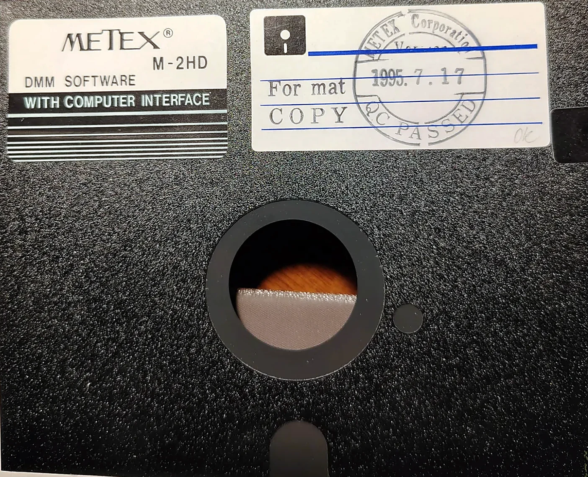

# Návod: použití přístroje s počítačem (str. 34–37)

Vlastními slovy shrnuje kapitoly 6-12 a 6-13 českého návodu „Digitální
multimetr s dvojitým displejem, řada M-3600D“. Fotky originálních stran:

| [str. 34](foto/manual-str34.jpg) | [str. 35](foto/manual-str35.jpg) | [str. 36](foto/manual-str36.jpg) | [str. 37](foto/manual-str37.jpg) |
|---|---|---|---|
|  |  |  |  |

## 6-12 Použití přístroje s počítačem

- **Komunikace** u multimetrů Metex znamená, že přístroj umí přes sériové
  rozhraní RS-232C poslat zprávu v ASCII. Zpráva obsahuje naměřený údaj
  a informaci o poloze otočného přepínače. (Návod tu omylem uvádí model
  M-3850.)
- **Dva režimy:**
  - **Aktivní** – na displeji svítí **COM** a zapíná se tlačítkem
    **FUNCTION**. Přístroj sám posílá zprávy, podle návodu zhruba jednou za sekundu,
    i když počítač nic nepřijímá nebo vůbec není připojený.
  - **Pasivní** – komunikaci řídí počítač. Každou zprávu přístroj pošle
    jen jako odpověď na jeden povel. Povel pro odeslání právě naměřené
    hodnoty je znak **`D`** (velké D).
  - Po **zapnutí** a po každé **změně polohy otočného voliče** je přístroj
    vždy v pasivním režimu.
- **Propojení:** přístroj a sériový port PC se spojí kabelem RS-232C
  a pak se přístroj zapne.

## 6-13 Použití dodaného programového vybavení

Původní program je určen jen pro počítače IBM PC. Výrobce ho označuje za
ukázkový a výukový, dodávaný za cenu média, bez záruky a ne pro komerční
použití. Postup podle návodu:

1. Vytvořit si záložní kopii diskety.
2. Zkopírovat soubory na pevný disk, nebo pracovat jen se zálohou.
3. Přejít do adresáře s programy, např. `A:` nebo `CD C:\MTX_SW`.
4. V MS-DOS spustit **`METEX.EXE`**.
5. Klávesou **F10** otevřít menu.
6. V položce **SETUP** vybrat typ přístroje **DMM M36D**.
7. Při potížích program ukončit klávesami **Ctrl+Break**.

Poznámky z návodu:

- Program vyžaduje grafickou kartu a monitor **VGA**.
- Naměřená data se ukládají do souborů s příponou **`.3UT`**, přes menu
  **SHEET → NEW / OPEN**.
- Další informace jsou v nápovědě programu (HELP).
- **Frekvenci s počítačem neměřte, je-li střídavé napětí vyšší než 20 V.**

**Formát dat** (str. 36): textový řetězec ASCII o pevné délce **14 znaků**.
Znaky 1–2 jsou režim, 3–9 hodnota, 10–13 jednotka a 14 je CR. Příklady
z návodu jsou `DC -3.999 V` a `OH 3.999MOhm`. Podrobně viz
[protokol.md](protokol.md).

**Zapojení kabelu MT/RS232C** (str. 37): na straně přístroje, vztaženo
k přední straně, jde horní dvojice kolíků na piny DB9 **2 (RD)** a **4 (DTR)**,
dolní trojice na piny **7 (RTS)**, **3 (TD)** a **5 (GND)**. Viz
[zapojeni.md](zapojeni.md).

**Ukázka v BASICu** (str. 37) přečte jednu hodnotu. Program otevře COM1 na
1200 Bd, bez parity, se 7 bity a 2 stop bity. Parametry `RS,CS,DS,CD`
vypínají kontrolu řídicích signálů. Pak program pošle `"D"`, přečte 14 znaků
(`INPUT$(14,#2)`), vypíše je a port zavře.

**Komunikační parametry** (str. 37): 1200 Bd, ASCII 7 bitů, bez parity,
2 stop bity.

## Původní disketa

Přístroj se dodával s **5¼" disketou** (M-2HD = 1,2 MB HD) s nápisem
„METEX M-2HD – DMM SOFTWARE WITH COMPUTER INTERFACE“. Na štítku je razítko
METEX Corporation „QC PASSED“ s datem **17. 7. 1995** a poznámka „Format
COPY“. Podle návodu obsahuje DOSový program `METEX.EXE`, ve kterém se volí
typ přístroje „M36D“. Data ukládá do souborů `.3UT` a vyžaduje VGA.

Návod řady M-3600D od B&B Electronics zmiňuje ještě program pro
Windows 3.1 („Scopeview“) a pozdější náhradu `METVIEW.EXE` pro
Windows 95/NT. Na této disketě to ověřené není. Formát `.3UT` se nepodařilo
dohledat. Obsah diskety zatím nebyl přečten, protože k tomu je potřeba
mechanika 5¼".

Tato aplikace původní software plně nahrazuje a nic z něj nepotřebuje.
