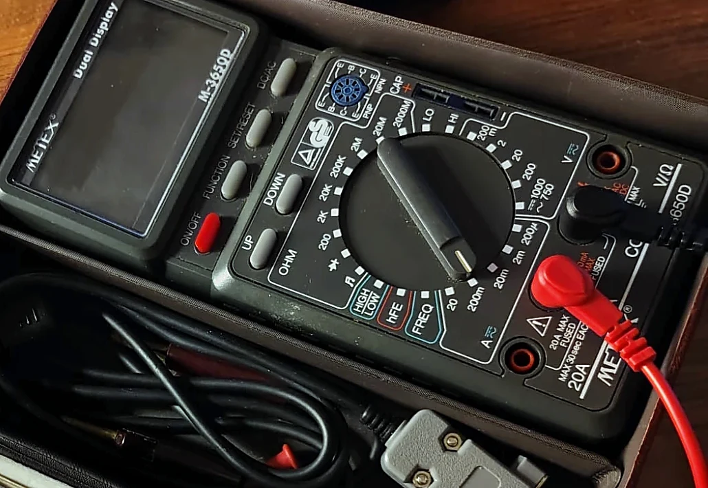
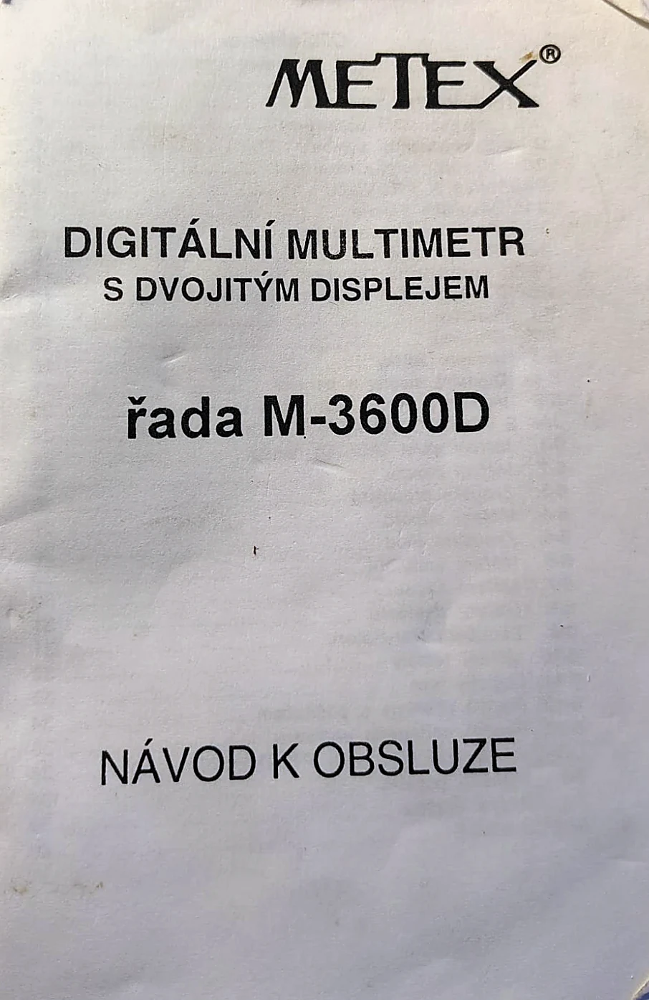

# Multimetr Metex M-3650D

Metex M-3650D je ruční číslicový multimetr řady **M-3600D** od korejské firmy
METEX Corporation. Na trhu byl od poloviny 90. let a v Česku se prodával
s českým návodem „Digitální multimetr s dvojitým displejem, řada M-3600D“.
Stejný přístroj se prodával i pod značkou **Voltcraft M-3650D** (Conrad);
pod tímto jménem ho uvádějí sigrok a QtDMM.

## Hlavní vlastnosti

- **Displej 3½ místa, 2000 bodů** (zobrazí nejvýše 1999). Návod řady
  M-3600D uvádí 1999 bodů; QtDMM u M-3650D uvádí 4000, což neodpovídá
  rozsahům 200 mV / 2 / 20 / 200 V.
- **Dvojitý displej** („Dual Display“). Hlavní displej ukazuje měřenou
  hodnotu. Vedlejší displej vpravo nahoře (FREQ) ukazuje frekvenci
  střídavého signálu současně s napětím nebo proudem.
- **Bargraf** se stupnicí 0–5–10–15–20. Při přetížení bliká.
- Rozhraní **RS-232C** s kabelem MT/RS232C, zdířka je v boku přístroje.
- Funkce **MIN/MAX, REL, MEM, A-H (auto-hold) a D-H (data-hold)**.
- Napájení z 9V baterie. Automatické vypnutí je během komunikace s PC
  podle návodu řady M-3600D vypnuté.

## Rozsahy

Volí se ručně otočným přepínačem.

| Funkce | Rozsahy | Režim v rámci |
|---|---|---|
| Stejnosměrné napětí | 200 mV, 2 V, 20 V, 200 V, 1000 V | `DC` |
| Střídavé napětí | 200 mV, 2 V, 20 V, 200 V, 750 V | `AC` |
| Stejnosměrný / střídavý proud | 200 µA, 2 mA, 20 mA, 200 mA, 20 A | `DC` / `AC` |
| Odpor | 200 Ω, 2 kΩ, 20 kΩ, 200 kΩ, 2 MΩ, 20 MΩ, 2000 MΩ | `OH` |
| Kapacita | 2 nF, 20 nF, 200 nF, 2 µF, 20 µF, 200 µF | `CA` |
| Frekvence | 2 kHz, 20 kHz, 200 kHz, 2 MHz, 20 MHz | `FR` |
| Tranzistor hFE | — | `HF` |
| Dioda, propojení | — | `DI` |
| Logický test (HIGH/LOW) | 0–19,99 V | (neověřeno) |

Rozsahy pocházejí z popisu přístroje a z návodu řady M-3600D (M-3640D,
B&B Electronics 1997). Kapacitní a frekvenční rozsahy jsou převzaté
z návodu, na přístroji jsou na krajích přepínače. 20A zdířka snese
nejvýše 20 A po dobu 30 s.

## Ovládací prvky

| Tlačítko | Funkce |
|---|---|
| **ON/OFF** | Zapnutí a vypnutí. |
| **DC/AC** | Přepnutí stejnosměrné a střídavé veličiny. |
| **SET/RESET** | Nastavení a vynulování (paměť, REL, MIN/MAX). |
| **FUNCTION** | Volba doplňkových funkcí (A-H, D-H, MIN, MAX, REL, MEM). Zapíná také **aktivní režim komunikace** (symbol COM). |
| **UP / DOWN** | Listování v nabídce funkcí a v paměti. |

Ručně psaný přehled vložený v kufříku odkazuje na strany návodu s funkcemi A-H,
D-H, MIN, MAX, REL a MEM.

## Logický test

Návod, str. 34:

- Černý vodič připojte na zem obvodu, červený na měřený bod.
- Přístroj porovná měřené napětí s hodnotou uloženou v paměti.
  - Nad 70 % uložené hodnoty ukáže **Hi**.
  - Pod 30 % ukáže **Lo**.
  - Mezi 30 a 70 % ukáže **——**.
- V tomto režimu nejsou k dispozici MAX, MIN ani Data-Hold.
- Obvod musí mít napájecí napětí vyšší než 3 V. Měřené napětí smí být
  0–19,99 V.

Co v tomto režimu přístroj posílá do PC, zatím nebylo ověřeno. libsigrok
rozpoznává texty `Hi` a `Lo` jako logické hodnoty. Aplikace takový rámec
zobrazí jako text a do statistiky ho nezapočítá.

## Bezpečnost při měření s PC

- **Rozsah se mění jen ručně.** V proudových rozsazích otočení přepínačem
  přeruší měřený obvod a na krajních polohách hrozí přepálení pojistky.
  Rozsah zvolte předem s rezervou.
- Když je na vstupu střídavé napětí **nad 20 V**, frekvenci s počítačem
  neměřte (návod, str. 36).
- Rozhraní je od měřicích obvodů galvanicky oddělené optočlenem. Přesto
  dodržujte bezpečnostní pokyny návodu pro měření na síti.
