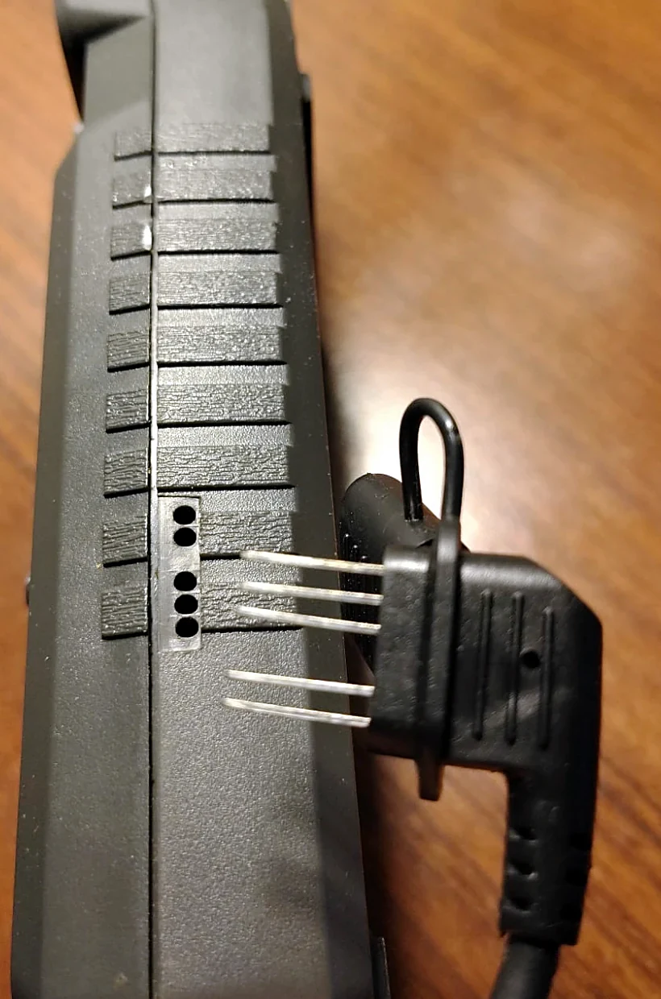
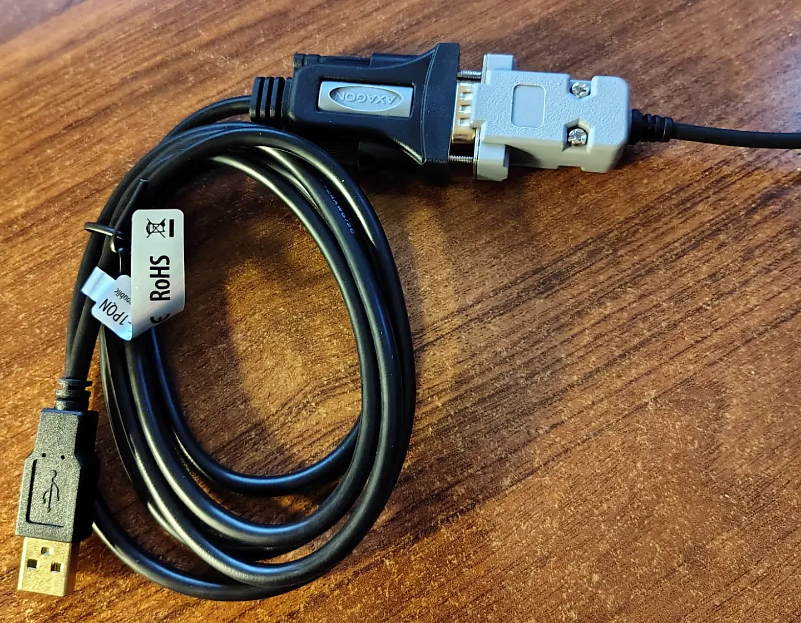

# Zapojení: přístroj – kabel MT/RS232C – převodník – PC

```
Metex M-3650D ──(5kolíková vidlice v boku)── kabel MT/RS232C ──(DB9 samice)──
    ──(DB9 samec) AXAGON ADS-1PQN (FTDI FT232R) ──USB── PC (Windows 11, COM10)
```

## Kabel MT/RS232C

Originální kabel je dodávaný v kufříku. Na straně přístroje má úhlovou
**pětikolíkovou vidlici** do zdířky v boku. Kolíky jsou ve dvou skupinách,
2 + 3. Na straně PC má **DB9 samici**.



Zapojení podle návodu (str. 37, obrázek „Připojení kabelu MT/RS232C
k multimetru“). Čísla jsou piny DB9 a pořadí odpovídá kolíkům na straně
přístroje, šipka ukazuje k přední straně přístroje:

| skupina kolíků | pin DB9 | signál (z pohledu PC) | význam pro Metex |
|---|---|---|---|
| horní (2 kolíky) | 2 | RxD (RD) | data z přístroje do PC |
| | 4 | DTR | napájení rozhraní, musí být **zapnuto** (+) |
| dolní (3 kolíky) | 7 | RTS | napájení rozhraní, musí být **vypnuto** (−) |
| | 3 | TxD (TD) | dotaz `D` z PC do přístroje |
| | 5 | GND | signálová zem |

Shoduje se to s wiki sigrok („Metex 5-pin RS232 cable“, verze s DE9 a mezerou
mezi kolíky 3 a 4). Ta číslování kolíků od druhé strany: přístroj 1 = GND (DE9
pin 5), 2 = TX (3), 3 = RTS (7), 4 = DTR (4), 5 = RX (2).

**Proč DTR a RTS:** rozhraní přístroje je oddělené optočlenem a nemá
vlastní napájení. Bere si ho z linek DTR (+) a RTS (−) sériového portu.
Bez správně nastavených DTR=1 a RTS=0 přístroj neodpovídá. Ve starém
BASICu (`OPEN "COM1:1200,N,7,2,RS,CS,DS,CD"`) se o to staral ovladač portu.
Tato aplikace DTR a RTS nastaví při otevření portu sama.

Kde přesně optočlen sedí, se zdroje rozcházejí. sigrok uvádí kabel jako
pasivní, bez součástek, takže optočlen je nejspíš v přístroji. Pro
použití to nehraje roli.

## Převodník USB–RS-232: AXAGON ADS-1PQN (ověřeno)



- Čip **FTDI FT232R** (originál), USB VID:PID **0403:6001**. Budič je
  TI TRS213, tedy plnohodnotné úrovně RS-232 včetně DTR a RTS.
- Ve Windows 11 se ovladač FTDI nainstaluje automaticky a převodník se
  objeví jako „USB Serial Port (COM10)“. Číslo COM se může na jiném PC
  nebo v jiném USB portu lišit, aplikace ukazuje VID:PID.
- DB9 samice kabelu Metexu se nasune **přímo** na DB9 samec převodníku.
  Žádná redukce, křížení ani pájení nejsou potřeba.

Ověřeno 22. 11. 2026: odpovědi `DC  00.00   V\r` na rozsahu 20 V, asi
2,8 vzorku/s, bez chybných rámců.

## Nefunkční převodníky

**TTL převodníky se čtyřmi Dupont vodiči (5V, GND, TX, RX), např. PL2303,
nefungují:**

- nemají DTR ani RTS, takže rozhraní Metexu nemá napájení;
- i kdyby se napájení zajistilo jinak, úrovně TTL mají proti RS-232 opačnou
  polaritu (klid = 0 V) a bez invertoru se data nepřečtou.

Ověřeno 21. 11. 2026 s převodníky PL2303 (VID:PID 067B:2303). Windows 11
k těmto starým čipům navíc nemá ovladač.

Použitelný je jen převodník s úplným RS-232 (konektor DB9 samec, úrovně
±5 až ±12 V, vyvedené DTR a RTS), například s čipem FTDI, Prolific PL2303GT
nebo CH340 a budičem MAX3232.

## Postup zapojení

1. Multimetr nechte **vypnutý**, měřicí hroty zatím nezapojujte do obvodu.
2. Kabel MT/RS232C zasuňte do zdířky v boku přístroje. Úhlový konektor míří
   kabelem dolů, viz fotka výše.
3. DB9 samici kabelu nasuňte na převodník a dotáhněte šroubky.
4. Převodník zapojte do USB. Ve Správci zařízení se objeví „Porty (COM
   a LPT) → USB Serial Port (COMx)“.
5. Zapněte multimetr a zvolte funkci a rozsah.
6. Spusťte aplikaci (`Metex.bat`), vyberte port a klikněte **Připojit**.
   Do dvou sekund by se měla objevit hodnota.

## Když to nejde

| příznak | co zkontrolovat |
|---|---|
| port v seznamu chybí | Převodník je v USB? Ve Správci zařízení je bez vykřičníku? Klikněte **Obnovit**. |
| „port nedostupný“ | Port drží jiný program (terminál, QtDMM, sigrok). Zavřete ho. |
| „přístroj neodpovídá“ | Multimetr je zapnutý? Kabel je zasunutý v boku až na doraz? Převodník má úplné RS-232 s DTR a RTS? Je vybraný správný COM? |
| přichází jen samé chybné rámce | Jiná rychlost nebo formát. Aplikace používá pevně 1200 Bd 7N2, jiný program mohl port přestavit. Odpojte a připojte. |
| hodnoty chodí jen 1× za sekundu | Přístroj je v aktivním režimu (COM). To je v pořádku. Jinak tlačítkem FUNCTION nebo otočením přepínače se vrátí do pasivního. |
